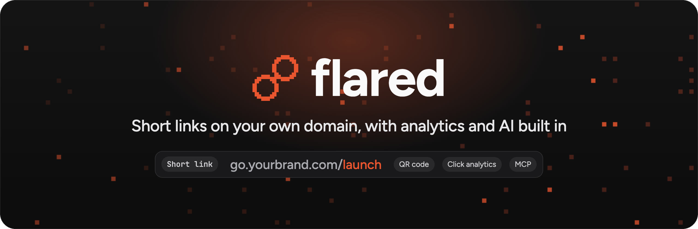
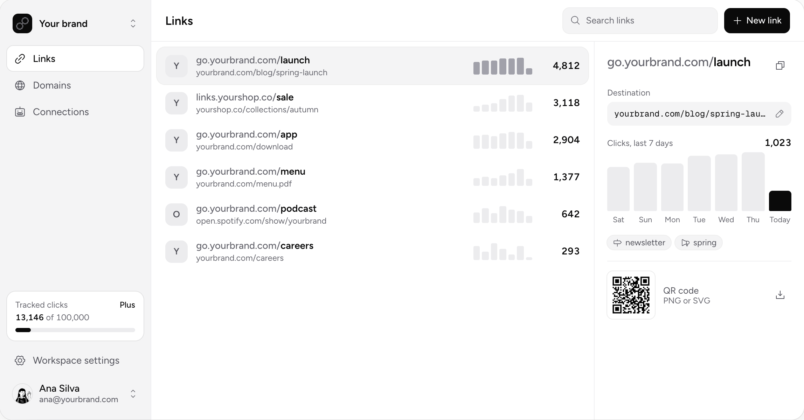
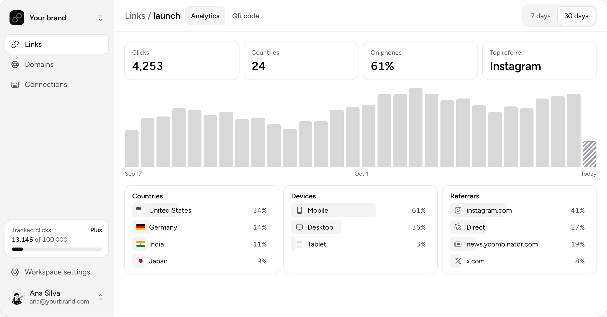
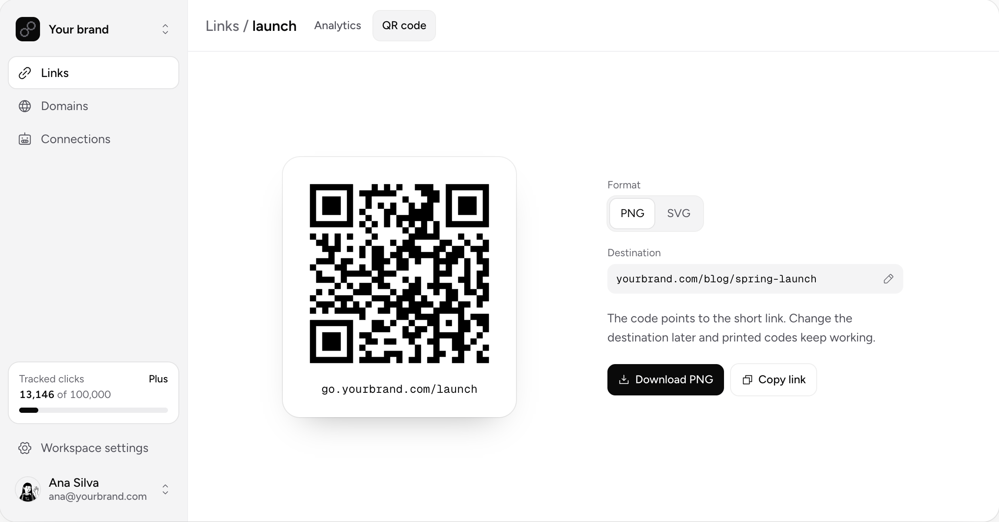
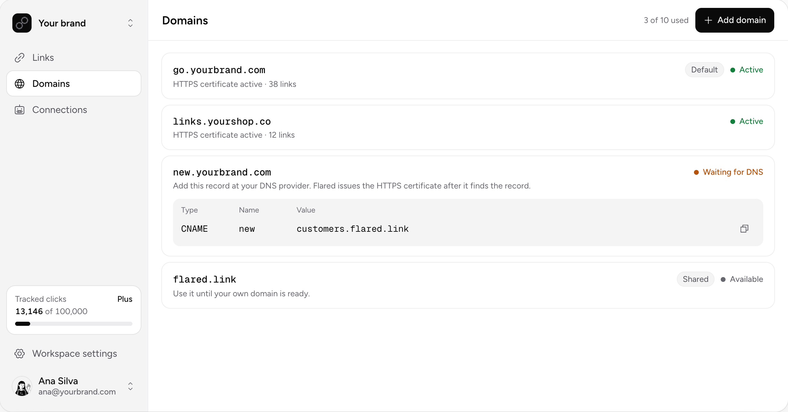
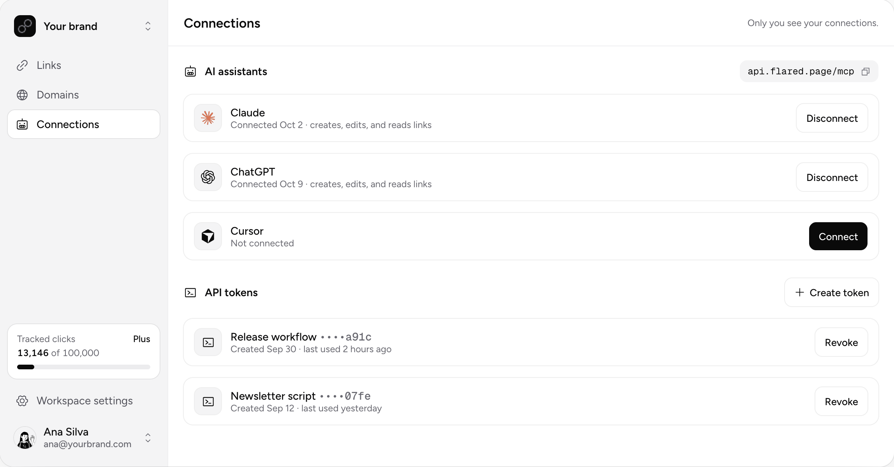

<p align="center">
  <a href="https://flared.page">
    
  </a>
</p>

<p align="center">
  <a href="https://flared.page/app/login?mode=signup"></a>
  &nbsp;
  <a href="https://deploy.workers.cloudflare.com/?url=https://github.com/FlaredLink/Flared"></a>
</p>

<p align="center">
  <a href="https://github.com/FlaredLink/Flared/releases/latest"></a>
  <a href="https://github.com/FlaredLink/Flared/actions/workflows/check.yml?query=branch%3Amain"></a>
  <a href="LICENSE.md"></a>
  <a href="https://www.npmjs.com/package/@flaredlink/cli"></a>
  <a href="https://flared.page/docs/assistants"></a>
  <br>
  
  
  
  
</p>

<p align="center">
  <b>Create, share, and measure short links from your app, your terminal, or your AI assistant.</b><br>
  Self-host it on Cloudflare in one click, or use <a href="https://flared.page">Flared Cloud</a>.
</p>

<p align="center">
  <a href="https://flared.page">🌐 Website</a> ·
  <a href="https://flared.page/docs">📖 Docs</a> ·
  <a href="https://flared.page/pricing">💳 Pricing</a> ·
  <a href="docs/self-hosting/deploy.md">🏠 Self-hosting</a> ·
  <a href="https://github.com/FlaredLink/Flared/releases">🚀 Releases</a>
</p>

<picture>
  <source media="(prefers-color-scheme: dark)" srcset=".github/assets/screenshots/links-dark.png">
  
</picture>

## ✨ Features

|     |                       |                                                                                             |
| --- | --------------------- | ------------------------------------------------------------------------------------------- |
| 🔗  | **Short links**       | Your own domain, custom slugs, UTM builder, iPhone and Android links, passwords, link cards |
| 📊  | **Click analytics**   | Clicks by day, country, device, browser, OS, and referrer                                   |
| 🔳  | **QR codes**          | PNG or SVG for every link                                                                   |
| 🤖  | **AI assistants**     | Remote MCP server with OAuth for Claude, ChatGPT, Cursor, and more                          |
| ⌨️  | **API and CLI**       | REST API with OpenAPI, API tokens, and the `flared` command                                 |
| ⚡  | **Automations**       | Change or turn off a link on a date, after N clicks, or when the destination is down        |
| 🪝  | **Webhooks**          | Signed events for link changes and click milestones                                         |
| 👥  | **Team**              | Invite members to your workspace                                                            |
| 🔐  | **Sign-in**           | Passkeys, plus email codes in the cloud or passwords when self-hosted                       |
| 📦  | **Export and import** | Take all your links and analytics with you as JSON or CSV                                   |

<table>
  <tr>
    <td width="50%">
      <picture>
        <source media="(prefers-color-scheme: dark)" srcset=".github/assets/screenshots/analytics-dark.png">
        
      </picture>
      <p align="center">📊 Analytics</p>
    </td>
    <td width="50%">
      <picture>
        <source media="(prefers-color-scheme: dark)" srcset=".github/assets/screenshots/qr-dark.png">
        
      </picture>
      <p align="center">🔳 QR codes</p>
    </td>
  </tr>
  <tr>
    <td width="50%">
      <picture>
        <source media="(prefers-color-scheme: dark)" srcset=".github/assets/screenshots/domains-dark.png">
        
      </picture>
      <p align="center">🌐 Domains</p>
    </td>
    <td width="50%">
      <picture>
        <source media="(prefers-color-scheme: dark)" srcset=".github/assets/screenshots/connections-dark.png">
        
      </picture>
      <p align="center">🤖 Connections</p>
    </td>
  </tr>
</table>

## 🚀 Get started

|                | ☁️ **Flared Cloud**                                               | 🏠 **Self-hosted**                                                                              |
| -------------- | ----------------------------------------------------------------- | ----------------------------------------------------------------------------------------------- |
| Set up         | Sign up and create your first link                                | One-click deploy to your Cloudflare account                                                     |
| Short links on | `flared.link` or your own domain                                  | Your Worker address or your own domain                                                          |
| Workspaces     | Many                                                              | One                                                                                             |
| Sign-in        | Email code, magic link, or passkey                                | Username and password, or passkey                                                               |
| Integrations   | Slack, Microsoft Teams, Zapier, analytics forwarding              | Webhooks                                                                                        |
| Cost           | Free plan, no credit card. [Pricing](https://flared.page/pricing) | Free on Workers Free                                                                            |
|                | **[Start free →](https://flared.page/app/login?mode=signup)**     | **[Deploy →](https://deploy.workers.cloudflare.com/?url=https://github.com/FlaredLink/Flared)** |

### 🏠 Deploy on Cloudflare

[](https://deploy.workers.cloudflare.com/?url=https://github.com/FlaredLink/Flared)

1. Click **Deploy to Cloudflare** and enter a `SETUP_SECRET` of at least 16 characters.
2. Cloudflare creates the databases and queues and deploys the Worker.
3. Open the Worker address, enter the secret at `/setup`, and create your account.

You need a Cloudflare account (Workers Free works) and a GitHub or GitLab account. Full guide: [docs/self-hosting/deploy.md](docs/self-hosting/deploy.md).

## 🤖 Connect your AI assistant

Add Flared as a remote MCP server. Your assistant signs in with OAuth.

```text
https://api.flared.page/mcp          # Flared Cloud
https://YOUR-APP-ADDRESS/mcp         # Self-hosted
```

19 tools: create, edit, and turn off links, read analytics and QR codes, import and export links, apply automations, and create and edit link pages. Setup for each assistant: [flared.page/docs/assistants](https://flared.page/docs/assistants).

## ⌨️ Use the CLI

```sh
npm install -g @flaredlink/cli
flared login
flared link create https://example.com/launch --slug launch
flared analytics launch
```

All commands: [packages/cli](packages/cli/README.md).

## 📚 Self-hosting guides

| Guide                                               | Topic                              |
| --------------------------------------------------- | ---------------------------------- |
| 🚀 [Deploy](docs/self-hosting/deploy.md)            | Deploy and set up the owner        |
| 🌐 [Domains](docs/self-hosting/domains.md)          | Short links on your own domains    |
| 🏷️ [App address](docs/self-hosting/origin.md)       | Move the app to your own address   |
| 👥 [Members](docs/self-hosting/members.md)          | Invite links and password resets   |
| 📏 [Limits](docs/self-hosting/limits.md)            | Change the workspace limits        |
| 🪝 [Webhooks](docs/self-hosting/webhooks.md)        | Send events to your endpoints      |
| ⚡ [Automations](docs/self-hosting/automations.md)  | Templates and destination checks   |
| 🔒 [Link access](docs/self-hosting/link-access.md)  | Start and end times, passwords     |
| 🖼️ [Link cards](docs/self-hosting/link-previews.md) | Card title, description, and image |
| ⬆️ [Upgrade](docs/self-hosting/upgrade.md)          | Get new releases as pull requests  |
| 💾 [Backups](docs/self-hosting/backups.md)          | Restore with D1 Time Travel        |
| 🔑 [Recovery](docs/self-hosting/recovery.md)        | Reset a forgotten owner password   |

## 🛠️ Development

```sh
bun install --frozen-lockfile
bun run check && bun run format:check && bun run test
bun run dev
```

Tests run in Cloudflare's workerd runtime with real D1 storage and need no Cloudflare account. Package and API reference: [docs/reference.md](docs/reference.md). Contributor rules: [AGENTS.md](AGENTS.md).

## 📄 License

Copyright (C) 2026 PGHQdev. Flared core is licensed under [AGPL-3.0-only](LICENSE.md). You may use, modify, self-host, and redistribute it, also commercially. If you run a modified version for other users over a network, offer them its source. Flared Cloud is a separate application and is not covered by this license.

<p align="center">
  <a href="https://flared.page"></a><br>
  <sub>Made by <a href="https://x.com/PGHQdev">@PGHQdev</a> · <a href="https://flared.page">flared.page</a></sub>
</p>
